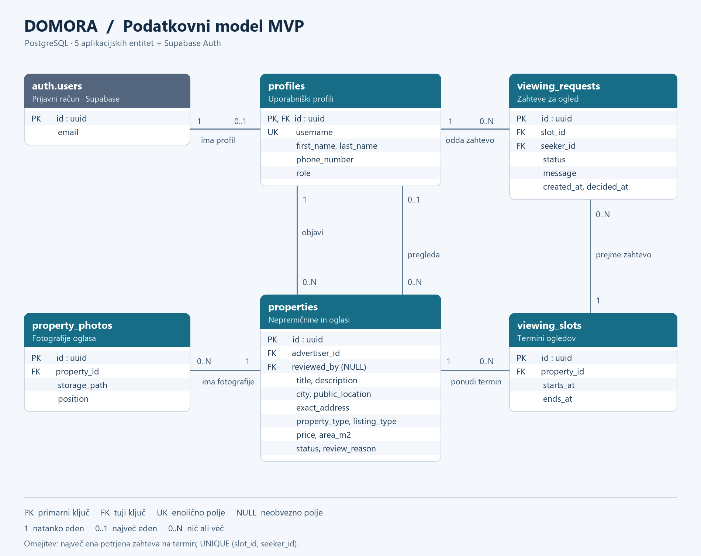

# Domora – podatkovni model

Podatki bodo shranjeni v relacijski bazi PostgreSQL na platformi Supabase. Model prve različice vsebuje pet povezanih aplikacijskih entitet in povezavo s prijavnim računom Supabase Auth. Identifikatorji so tipa UUID, časovna polja pa `TIMESTAMPTZ`.

## Entitete in glavna polja

| Entiteta | Glavna polja |
|---|---|
| `profiles` – uporabniški profili | `id` (PK, FK → auth.users.id), `first_name`, `last_name`, `username` (UNIQUE), `phone_number`, `role` (SEEKER / ADVERTISER / ADMIN) |
| `properties` – nepremičnine in oglasi | `id` (PK), `advertiser_id` (FK → profiles.id), `title`, `description`, `city`, `public_location`, `exact_address`, `property_type`, `listing_type` (SALE / RENT), `price` (NUMERIC), `area_m2` (NUMERIC), `status`, `reviewed_by` (neobvezni FK → profiles.id), `review_reason` (neobvezno) |
| `property_photos` – fotografije | `id` (PK), `property_id` (FK → properties.id), `storage_path`, `position` |
| `viewing_slots` – termini ogledov | `id` (PK), `property_id` (FK → properties.id), `starts_at`, `ends_at` |
| `viewing_requests` – zahteve za ogled | `id` (PK), `slot_id` (FK → viewing_slots.id), `seeker_id` (FK → profiles.id), `status` (PENDING / CONFIRMED / REJECTED / CANCELLED), `message` (neobvezno), `created_at`, `decided_at` (neobvezno) |

Oglas ima status DRAFT, PENDING_REVIEW, PUBLISHED, REJECTED, INACTIVE, SOLD ali RENTED. Cena je v EUR: pri prodaji pomeni skupno ceno, pri oddaji mesečno najemnino. Fotografije so shranjene v Supabase Storage; baza hrani njihove poti. Prijavne podatke in gesla upravlja Supabase Auth.

## Povezave med entitetami

- Prijavni račun `auth.users` ima največ en profil; vsak profil pripada natanko enemu računu.
- Oglaševalec ima lahko več oglasov; vsak oglas ima enega oglaševalca.
- Administrator lahko pregleda več oglasov; oglas ima pred pregledom nič, po pregledu pa enega pregledovalca.
- Oglas ima lahko več fotografij in terminov; vsaka fotografija in vsak termin pripadata enemu oglasu.
- Termin ima lahko več zahtev; vsaka zahteva pripada enemu terminu in enemu interesentu. Interesent je lahko iskalec ali oglaševalec pri tujem oglasu.

## Osnutek podatkovnega modela – ER diagram

PK označuje primarni ključ, FK tuji ključ, UK pa enolično polje. `0..N` pomeni nič ali več povezanih zapisov. Diagram prikazuje glavna polja; celoten osnutek polj je naveden v tabeli zgoraj.

## Ključne omejitve modela

- Kombinacija `slot_id` in `seeker_id` je enolična, zato interesent ne more podvojiti zahteve za isti termin.
- Delni enolični indeks na `slot_id` za status CONFIRMED zagotavlja največ eno potrjeno zahtevo na termin. Potrditev in zavrnitev drugih čakajočih zahtev se izvedeta v isti transakciji.
- Konec termina mora biti po začetku; termini istega oglasa se ne smejo prekrivati.
- Javno so vidni samo oglasi PUBLISHED. Natančen naslov vidijo lastnik, administrator pri pregledu in interesent s potrjenim ogledom aktivnega oglasa.
