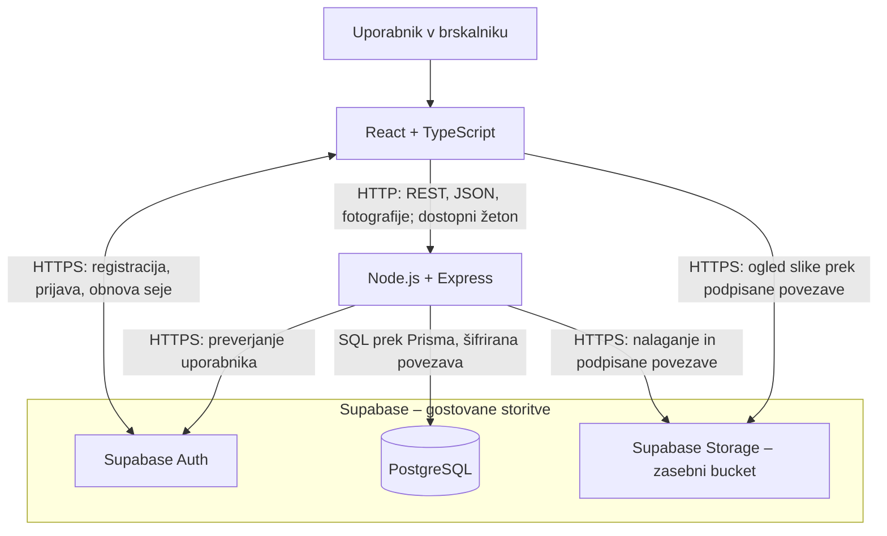

# Domora – arhitektura in tehnološki sklad

## Arhitekturni pristop

Rešitev bo sestavljena iz odzivnega spletnega uporabniškega vmesnika, enega backend strežnika in storitev Supabase. Backend bo modularni monolit: moduli za uporabnike, oglase, pregled objav in oglede bodo del iste aplikacije. Za obseg študentskega projekta ločene mikrostoritve niso potrebne.

**Podatkovna baza:** PostgreSQL, gostovan na platformi Supabase.

## Glavni deli sistema

1. **Frontend (React + TypeScript):** prikazuje iskanje in podrobnosti oglasov ter uporabniške poglede za iskalca, oglaševalca in administratorja.
2. **Backend REST API (Node.js + Express):** preverja identiteto, dovoljenja, podatke in poslovna pravila, zlasti odobritev oglasov ter potrjevanje ogledov.
3. **PostgreSQL na Supabase:** hrani uporabniške profile, oglase, metapodatke fotografij, termine in zahteve za ogled.
4. **Supabase Auth:** upravlja registracijo, prijavo, odjavo in prijavne seje.
5. **Supabase Storage:** hrani fotografije v zasebnem bucketu; backend nadzoruje nalaganje in izdajo povezav za ogled.

Frontend komunicira z backendom prek HTTP in JSON, fotografije pa nalaga kot `multipart/form-data`. Za prijavo uporablja Supabase SDK. Zaščitenim zahtevam na backend doda dostopni žeton v glavi `Authorization: Bearer <token>`. Backend dostopa do baze prek Prisma in do shrambe prek Supabase SDK. Brskalnik poslovne podatke pridobiva prek Express API, brez neposrednega dostopa do aplikacijskih tabel.

Po MVP se doda modul za interno sporočanje pri oglasih (F14). Iskalec ali oglaševalec pri tujem aktivnem oglasu pošlje zahtevo za pogovor, lastnik pa jo sprejme ali zavrne. Pogovori in sporočila se shranjujejo v PostgreSQL, frontend pa jih pošilja in pridobiva prek REST API. Backend preveri udeleženca in status: pošiljanje dovoli samo pri pogovoru `ACTIVE` in oglasu `PUBLISHED` brez `deleted_at`. Poslanih sporočil ni mogoče urejati ali brisati. Ob deaktivaciji, zaključku ali logičnem izbrisu prek F11 vsi pogovori postanejo `INACTIVE`; sporočila ostanejo berljiva, podatke oglasa pa za drugega udeleženca nadomesti oznaka »Oglas ni več aktiven« oziroma »Oglas je izbrisan«. Za začetno izvedbo zadostuje osveževanje zgodovine ob odprtju pogovora, po pošiljanju ali na zahtevo uporabnika.

## Preprost diagram



HTTP je namenjen lokalni komunikaciji s frontendom in backendom. Povezave do storitev Supabase so šifrirane; ob kasnejši javni namestitvi se tudi Express API in frontend ponudita prek HTTPS.

## Tehnološki sklad

[](https://react.dev/)
[](https://www.typescriptlang.org/)
[](https://nodejs.org/)
[](https://expressjs.com/)
[](https://www.postgresql.org/)
[](https://supabase.com/)

Logotipi so povezave do uradnih strani tehnologij.

| Del | Predvidene tehnologije in orodja | Namen |
|---|---|---|
| Frontend | React + TypeScript, Vite, React Router, CSS | Komponente, obrazci, usmerjanje med pogledi in odziven prikaz. |
| Backend | Node.js + Express, TypeScript | REST API in izvajanje poslovnih pravil. |
| Podatkovna baza | **PostgreSQL, gostovan na platformi Supabase** | Relacijsko shranjevanje, omejitve in transakcije. |
| Podatkovni sloj | Prisma in SQL migracije | Dostop do podatkov in razvoj sheme; posebne omejitve se dodajo s SQL migracijami. |
| Avtentikacija | Supabase Auth, `@supabase/supabase-js` | Prijava z e-pošto in geslom ter upravljanje prijavnih sej. |
| Fotografije | Supabase Storage, Multer | Backend sprejme in preveri slike ter jih shrani v zasebni bucket. |
| Lokalni razvoj | Docker, Docker Compose, npm, Git | Lokalni zagon frontenda in backenda ter upravljanje izvorne kode. |
| Preverjanje API | Postman ali podobno orodje | Preverjanje odgovorov, vlog in poslovnih scenarijev. |

## Avtentikacija in upravljanje uporabnikov

- Supabase Auth upravlja registracijo in prijavo z e-pošto ter geslom. Aplikacija ne hrani gesel ali njihovih zgoščenih vrednosti.
- Po registraciji frontend prek zaščitenega API ustvari profil z imenom, priimkom, uporabniškim imenom, telefonom in neobveznim datumom rojstva. Backend dovoli samo vlogi `SEEKER` in `ADVERTISER`; profil se ustvari največ enkrat. Poskusi dodelitve vloge `ADMIN` se zavrnejo.
- Uporabnik brez aplikacijskega profila lahko pregleduje javne oglase. Za objavo, zahtevo za ogled ali pogovor backend zahteva dokončan profil; frontend ob naslednji prijavi ponudi dokončanje.
- Poslovna vloga je shranjena v tabeli `profiles`. Backend je ne prevzame iz podatkov, ki jih uporabnik lahko sam spreminja v Supabase Auth. Akcija »Postani oglaševalec« preveri obvezne profilne podatke in spremeni `SEEKER` v `ADVERTISER` na istem UUID; običajno urejanje profila ne dovoljuje spremembe vloge.
- Administrator se ustvari z inicializacijskim skriptom prek strežniškega Auth Admin API, ki mu dodeli profil z vlogo `ADMIN`. Začetni podatki se podajo prek okoljskih spremenljivk.
- Supabase SDK v frontendu upravlja prijavno sejo in obnovo žetonov. Backend za zaščitene operacije preveri dostopni žeton s `supabase.auth.getUser(token)`; ne zaupa zgolj dekodirani vsebini žetona.
- Backend nato preveri vlogo iz aplikacijske baze in lastništvo zapisa. Skrivanje gumbov v frontendu ni nadomestilo za nadzor dostopa.
- Vloga `ADVERTISER` vključuje pravice `SEEKER`: iskanje, zahteve za ogled in po MVP zahteve za pogovor pri tujih oglasih. Backend zavrne zahteve za ogled ali pogovor pri lastnem oglasu. Vloga `SEEKER` ne dovoljuje objavljanja oglasov.
- Javni odgovor vključuje `public_location`, ne `exact_address`. Natančen naslov in navodila backend vrne lastniku, naslov tudi administratorju pri pregledu, interesentu pa samo pri potrjenem ogledu aktivnega oglasa. Sprejet pogovor ni pogoj za ogled.
- Odgovori o profilih vsebujejo samo dovoljena polja: javno uporabniško ime, pri prejeti zahtevi ime in morebitno izračunano starost interesenta, po potrditvi ogleda pa tudi kontaktni telefon drugega udeleženca. Datum rojstva drugim uporabnikom ni vrnjen. Sprejet pogovor razkrije ime in morebitno starost, samodejno pa ne telefona.
- Po odjavi frontend odstrani sejo. Že izdani dostopni žeton lahko ostane veljaven do poteka, zato se dovoljenja preverijo ob vsaki zahtevi; pri kasnejšem onemogočanju računov se preverja tudi `profiles.is_active`.
- Frontend uporablja samo URL projekta in javni publishable ključ. Strežniški secret ključ in povezava do baze ostaneta izključno v backend okolju.
- Aplikacijske tabele imajo omogočen RLS brez politik za neposredni dostop brskalnika. Prisma uporablja namensko strežniško podatkovno vlogo z `BYPASSRLS` in dovoljenji samo za potrebne aplikacijske tabele; avtorizacijo poslovnih operacij izvaja Express. Ta povezava ni dostopna frontendu.
- Za nalaganje slik se uporablja zasebni bucket. Backend po preverjanju dostopa izda časovno omejeno podpisano povezavo: za aktivne oglase tudi obiskovalcu, za druge neizbrisane oglase samo lastniku in administratorju. Za logično izbrisane oglase ne izdaja novih povezav; že izdane povezave potečejo po omejenem času.

## Primeri REST operacij

| Operacija | Pot | Dostop in pomen |
|---|---|---|
| POST | `/api/me/profile` | Preverjen uporabnik ustvari profil z dovoljeno vlogo iskalca ali oglaševalca. |
| PATCH | `/api/me/profile` | Uporabnik ureja lastne profilne podatke, brez neposredne spremembe vloge. |
| POST | `/api/me/become-advertiser` | Iskalec po preverjanju profila postane oglaševalec; UUID in povezave se ohranijo. |
| GET | `/api/properties` | Javno iskanje aktivnih oglasov (`PUBLISHED`, `deleted_at IS NULL`); filtri v poizvedbenih parametrih. |
| POST | `/api/properties` | Oglaševalec pripravi svoj osnutek. |
| POST | `/api/properties/:id/submit` | Lastnik odda popoln neizbrisan osnutek ali zavrnjen oglas v pregled; ob ponovni oddaji se podatki zadnjega pregleda izpraznijo. |
| POST | `/api/properties/:id/review` | Administrator odobri ali zavrne oglas v pregledu. |
| POST | `/api/properties/:id/slots` | Lastnik objavljenega oglasa določi termin. |
| POST | `/api/slots/:id/requests` | Iskalec ali oglaševalec odda zahtevo za ogled tuje objavljene nepremičnine. |
| POST | `/api/viewing-requests/:id/decision` | Lastnik aktivnega oglasa pred začetkom termina potrdi ali zavrne čakajočo zahtevo; ob potrditvi lahko doda navodila za zbirno mesto. |
| GET | `/api/me/viewing-requests` | Iskalec ali oglaševalec vidi svoje oddane zahteve in njihove statuse. |
| POST | `/api/properties/:id/close` | Lastnik aktivnega oglasa nastavi `INACTIVE`, `SOLD` ali `RENTED`; zadnja dva statusa sta odvisna od namena oglasa (MVP, F11). |
| DELETE | `/api/properties/:id` | Lastnik svoj oglas logično izbriše prek `deleted_at`, brez fizičnega brisanja povezav (MVP, F11). |

Po MVP se za F14 dodajo naslednje operacije:

| Operacija | Pot | Dostop in pomen |
|---|---|---|
| POST | `/api/properties/:id/conversations` | Iskalec ali oglaševalec pri tujem objavljenem oglasu pošlje zahtevo za pogovor (`PENDING`). |
| POST | `/api/conversations/:id/decision` | Lastnik oglasa sprejme ali zavrne čakajočo zahtevo in zabeleži `decided_at`. |
| GET | `/api/conversations/:id/messages` | Udeleženec pregleduje zgodovino, tudi ko je pogovor `INACTIVE`. |
| POST | `/api/conversations/:id/messages` | Udeleženec pošlje novo sporočilo samo pri `ACTIVE` in objavljenem oglasu. |

Deaktivacija, zaključek in logični izbris so del MVP: v eni transakciji spremenijo status oziroma `deleted_at` ter prekličejo prihodnje čakajoče in potrjene oglede. Po uvedbi F14 ista transakcija pogovore zapre v `INACTIVE` in ob prvem zaprtju zabeleži `closed_at`. Operacije zaklepajo najprej oglas in nato termin ali pogovor. Vsi javni odgovori in nove poslovne operacije preverijo `PUBLISHED` ter `deleted_at IS NULL`.

Lastnik vidi svoje neaktivne oglase, izbrisani pa izginejo iz njegovega običajnega seznama. Drugim uporabnikom zgodovina vrne samo oznako nedostopnega oglasa, brez podrobnosti nepremičnine, fotografij, natančnega naslova ali navodil. Branje obstoječih sporočil je dovoljeno udeležencema tudi pri zaprtem ali logično izbrisanem oglasu.

Po začetku termina se čakajoča zahteva prikaže kot »Pretekla zahteva«, čeprav v bazi ostane `PENDING`; API zavrne potrditev in zavrnitev. Po uvedbi F10 ponovna prijava na termin reaktivira isti zapis `CANCELLED` v `PENDING` ter ponastavi prejšnjo odločitev, navodila in čas preklica. Dovoljena je samo pri prihodnjem prostem terminu in aktivnem oglasu; `REJECTED` se ne more ponovno aktivirati.

Backend vrne `401` za manjkajočo ali neveljavno prijavo, `403` za nedovoljen dostop, `400` za neveljavne podatke in `409` za konflikt, na primer zaseden termin. Osebni podatki drugih iskalcev niso vključeni v javne odgovore.

## Način lokalnega zagona

Frontend in backend se izvajata lokalno, baza, avtentikacija in fotografije pa uporabljajo ločen razvojni projekt na Supabase. Za tak zagon je potrebna internetna povezava.

Predvidene storitve v `compose.yaml`:

- `frontend`: razvojni strežnik na `http://localhost:5173`.
- `backend`: API na `http://localhost:3000`.

Vite zahteve `/api` posreduje backendu. Lokalni PostgreSQL in volumen za fotografije nista potrebna, ker podatke hranijo gostovane storitve Supabase.

Predvideni postopek po implementaciji:

1. Ustvarimo razvojni projekt Supabase in nastavimo prijavo z e-pošto ter dovoljeni povratni URL `http://localhost:5173`.
2. Kopiramo `.env.example` v `.env` in vnesemo konfiguracijo:
   - `VITE_SUPABASE_URL` in `VITE_SUPABASE_PUBLISHABLE_KEY` za frontend;
   - `SUPABASE_URL`, `SUPABASE_SECRET_KEY`, `DATABASE_URL` in `DIRECT_URL` za backend oziroma migracije;
   - `ADMIN_EMAIL` in `ADMIN_PASSWORD` za začetni administratorski račun.
3. Povezovalne nize za Prisma in migracije izberemo iz nastavitev povezave projekta Supabase, glede na način povezovanja in podporo omrežja.
4. Zaženemo spodnje ukaze. Ponovljivi seed ustvari administratorja prek Supabase Auth, demonstracijske podatke in zasebni bucket `property-photos`.

```bash
cp .env.example .env
# V .env vnesite konfiguracijo razvojnega projekta Supabase.
docker compose build
docker compose run --rm backend npx prisma migrate deploy
docker compose run --rm backend npm run seed
docker compose up -d
```

Migracije upravljajo aplikacijske tabele in omejitve; shemi `auth` in `storage` upravlja Supabase. Prisma bo nastavljena tako, da za migracije uporabi `DIRECT_URL`. Navedeni ukazi so načrt zagona; aplikacija v tej nalogi še ni implementirana.

Podatki baze in fotografije ostanejo na Supabase tudi po ustavitvi lokalnih vsebnikov. Datoteka `.env` se ne vključi v Git; `.env.example` vsebuje samo primere in opise spremenljivk. Spremenljivke s predpono `VITE_` so javne, zato ne smejo vsebovati strežniških skrivnosti.

## Utemeljitev arhitekturnih odločitev

- **React in TypeScript:** podpirata ponovno uporabo komponent in preverjanje tipov pri različnih uporabniških pogledih.
- **REST API in modularni monolit:** omogočata jasno ločitev vmesnika od poslovnih pravil ter preprost razvoj in lokalni zagon.
- **PostgreSQL na Supabase:** ohranja relacijske povezave in transakcije, gostovanje pa zmanjša obseg lokalne infrastrukture.
- **Prisma z dodatnimi SQL migracijami:** olajša običajne poizvedbe; delni enolični indeks za potrjen ogled se definira neposredno v SQL.
- **Supabase Auth:** prevzame upravljanje prijavnih računov in sej. Aplikacija ločeno določa poslovne vloge ter dovoljenja.
- **Supabase Storage:** fotografije hrani zunaj aplikacijskih tabel. Zasebni bucket in podpisane povezave omogočajo nadzor dostopa pred objavo. Backend omeji velikost na 5 MB na sliko, največ 10 slik na oglas, preveri vsebino formata JPEG ali PNG in ustvari imena objektov.
- **Transakcije in podatkovne omejitve:** ob sočasnem potrjevanju zagotavljajo največ en potrjen ogled na termin.
- **Docker Compose:** poenoti lokalno izvajanje frontenda in backenda; gostovane storitve uporabljata prek konfiguracije okolja.

## Predvideno preverjanje MVP

Preverjeni bodo celoten proces objave in ogleda, zavrnitev ter ponovna oddaja oglasa, dostop do tujih zapisov, podvojene zahteve, prekrivanje terminov in sočasna potrditev dveh zahtev za isti termin. Preverjeno bo tudi zavračanje neveljavnih žetonov in poskusov dodelitve vloge `ADMIN`, zasebnost neobjavljenih oglasov ter fotografij in ohranitev podatkov po ponovnem lokalnem zagonu.

Preverjeno bo, da oglaševalec lahko zahteva ogled tuje nepremičnine, iskalec ne more objavljati oglasov in nihče ne more zahtevati ogleda pri lastnem oglasu. Preverijo se prehod v oglaševalca z ohranjenim UUID, dokončanje profila in dovoljen prikaz profilnih podatkov. Preverjeni bodo deaktivacija, prodaja, oddaja in logični izbris, preklic prihodnjih zahtev, nedostopnost podrobnosti drugim uporabnikom ter ohranjene povezave v zgodovini.

Javni odgovor mora vsebovati samo javno lokacijo. Natančen naslov in navodila se razkrijeta interesentu šele ob potrjenem ogledu aktivnega oglasa, neodvisno od pogovora. Preverijo se dovoljene oznake glede na SALE / RENT, ponastavitev pregleda ob ponovni oddaji ter prepoved odločanja o preteklih zahtevah.

Po uvedbi F14 se preverijo zahteva za pogovor, sprejem ali zavrnitev, prepoved sporočanja pred sprejetjem, dostop samo udeležencev, nespremenljivost poslanih sporočil ter zaprtje pogovorov ob zaključku oglasa z ohranjeno zgodovino. Preveri se tudi sočasno pošiljanje sporočila in zaključek oglasa.

Po uvedbi F10 se preveri, da ponovna prijava reaktivira isti preklicani zapis in počisti prejšnjo odločitev ter navodila, zavrnjenega zapisa pa ne reaktivira.

## Povezave do dokumentacije

- [Supabase Auth – uporabniški profili in povezava z auth.users](https://supabase.com/docs/guides/auth/managing-user-data)
- [Supabase Auth – preverjanje uporabnika z getUser](https://supabase.com/docs/reference/javascript/auth-getuser)
- [Supabase Storage – zasebni bucketi in podpisane povezave](https://supabase.com/docs/guides/storage/buckets/fundamentals)
- [Supabase PostgreSQL – povezovanje s Prisma](https://supabase.com/docs/guides/database/prisma)
