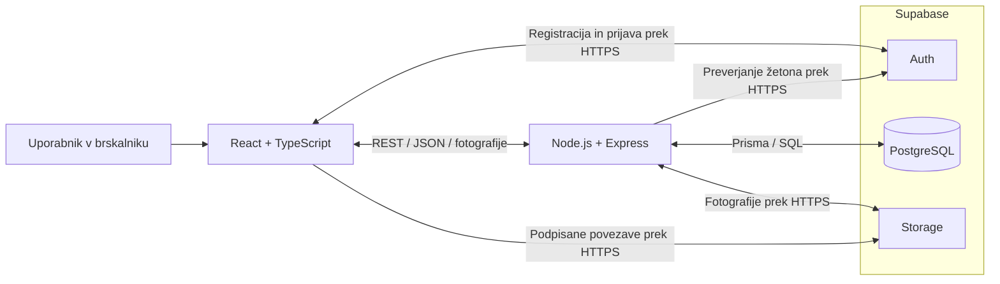

# Domora – arhitektura in tehnološki sklad

## Arhitektura

Rešitev sestavljajo odziven spletni vmesnik, en backend strežnik in storitve Supabase. Backend je modularni monolit z moduli za uporabnike, oglase, administratorski pregled in oglede.

| Del sistema | Naloga |
|---|---|
| Frontend | Iskanje in prikaz oglasov, obrazci ter pogledi za posamezne uporabniške vloge. |
| Backend REST API | Preverjanje dovoljenj, izvajanje poslovnih pravil in dostop do podatkov. |
| PostgreSQL na Supabase | Shranjevanje profilov, oglasov, poti fotografij, terminov in zahtev za ogled. |
| Supabase Auth | Registracija, prijava in upravljanje prijavnih sej. |
| Supabase Storage | Shranjevanje fotografij nepremičnin. |

### Komunikacija med deli

Frontend poslovne podatke pridobiva prek REST API v obliki JSON, fotografije pa nalaga prek `multipart/form-data`. Za prijavo uporablja Supabase Auth. Zaščitenim zahtevam doda dostopni žeton, ki ga backend preveri skupaj z vlogo in lastništvom podatkov. Backend dostopa do PostgreSQL prek Prisma in do fotografij prek Supabase SDK. Povezave do Supabase uporabljajo HTTPS oziroma šifrirano povezavo z bazo.

### Diagram arhitekture



### Avtentikacija in upravljanje uporabnikov

Supabase Auth upravlja prijavo z e-pošto in geslom; aplikacija gesel ne shranjuje. Vloga je shranjena v tabeli `profiles`. Uporabnik se registrira kot iskalec ali oglaševalec, administratorski račun pa se ustvari z inicializacijskim skriptom. Backend pri vsaki zaščiteni operaciji preveri identiteto, vlogo in dostop do konkretnega zapisa. Strežniški ključi in povezava do baze so shranjeni samo v okolju backenda.

### Način lokalnega zagona

Po implementaciji bo Docker Compose zagnal frontend na `http://localhost:5173` in backend na `http://localhost:3000`. Baza, avtentikacija in fotografije bodo uporabljali razvojni projekt Supabase, zato bo potrebna internetna povezava.

1. Ustvarimo razvojni projekt Supabase.
2. Iz `.env.example` pripravimo `.env` z URL-jem projekta, javnim ključem za frontend ter strežniškim ključem in povezavo do baze za backend.
3. Zgradimo vsebnike, izvedemo migracije in inicializacijo administratorja ter zaženemo aplikacijo:

```bash
docker compose build
docker compose run --rm backend npx prisma migrate deploy
docker compose run --rm backend npm run seed
docker compose up -d
```

To je načrt lokalnega zagona; aplikacija pri tej nalogi še ni implementirana.

## Tehnološki sklad

| Področje | Tehnologije in orodja |
|---|---|
| Frontend | React, TypeScript, Vite, React Router, CSS |
| Backend | Node.js, Express, TypeScript |
| Podatkovna baza | PostgreSQL na Supabase, Prisma in SQL migracije |
| Avtentikacija | Supabase Auth, Supabase JavaScript SDK |
| Fotografije | Supabase Storage, Multer za sprejem datotek |
| Lokalni razvoj | Docker, Docker Compose, npm, Git |

## Utemeljitev arhitekturnih odločitev

- **React in TypeScript:** omogočata ponovno uporabo komponent in preverjanje tipov pri obrazcih ter različnih uporabniških pogledih.
- **REST API in modularni monolit:** ločita uporabniški vmesnik od poslovnih pravil ter omogočata preprost zagon in kasnejše dodajanje modulov.
- **PostgreSQL na Supabase:** podpira povezane entitete, tuje ključe in transakcije, gostovanje pa zmanjša lokalno infrastrukturo.
- **Prisma in SQL migracije:** olajšajo dostop do podatkov in spreminjanje sheme; posebne omejitve, kot je en potrjen ogled na termin, se določijo v SQL.
- **Supabase Auth:** prevzame upravljanje prijavnih računov in sej, aplikacija pa določa poslovne vloge ter dovoljenja.
- **Supabase Storage:** hrani fotografije zunaj baze; zasebna shramba in podpisane povezave omogočajo nadzor dostopa do neobjavljenih oglasov.
- **Docker Compose:** poenoti lokalno izvajanje frontenda in backenda.

## Zapisi arhitekturnih odločitev

Razloge izbire, alternative in posledice posameznih odločitev dokumentirajo [ADR 0001–0007](adr/README.md). Ob spremembi sprejete odločitve dodamo nov ADR in označimo, kateri zapis nadomešča.
