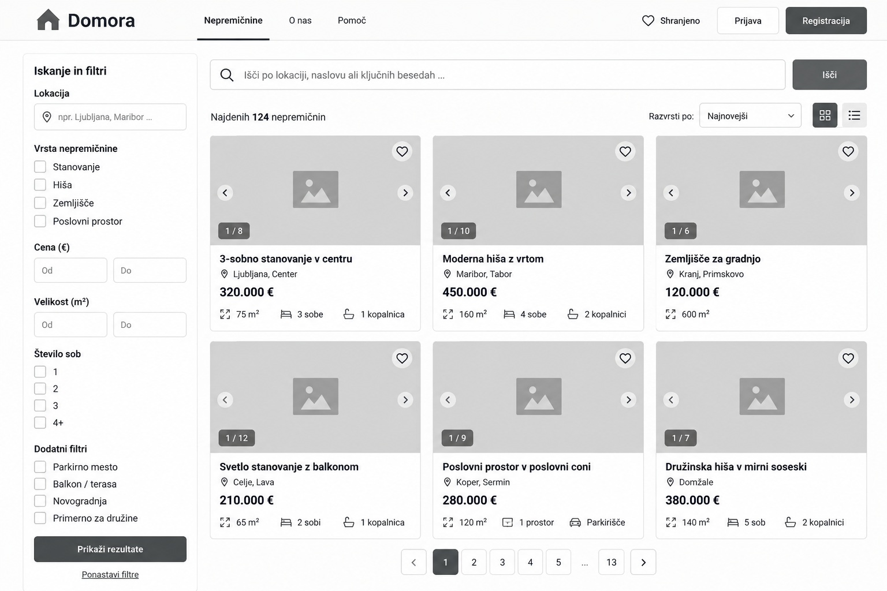
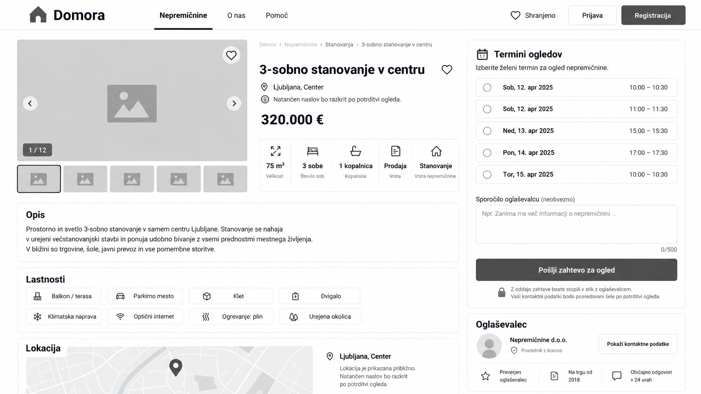
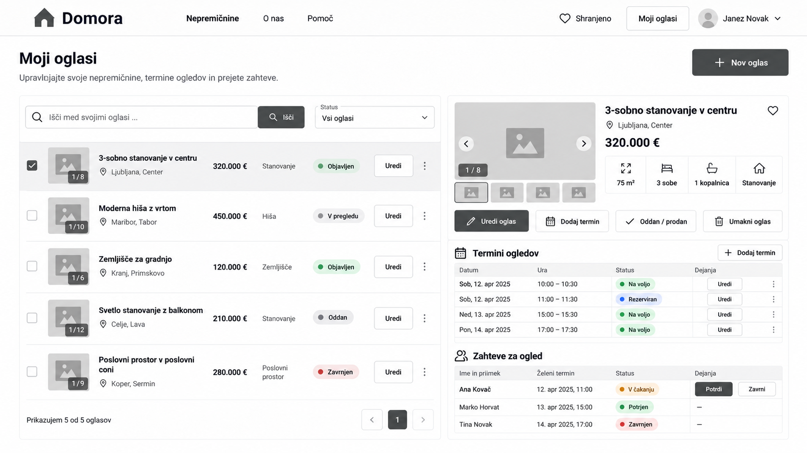
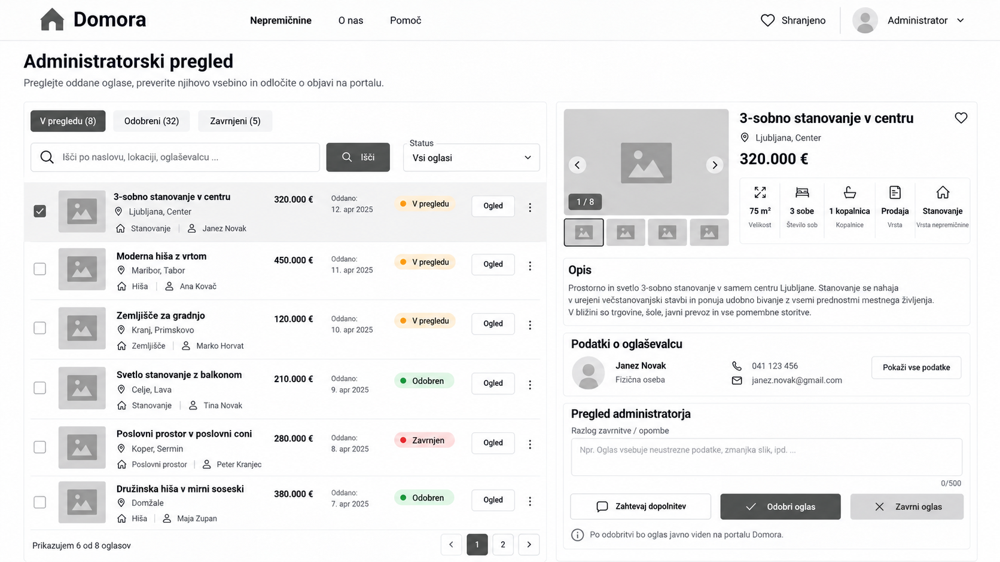

# Domora – žični modeli (MVP)

## 1. Iskanje nepremičnin

Javni pregled objavljenih oglasov s fotografijo, krajem, ceno in površino ter filtri za kraj, ceno, površino in vrsto nepremičnine (F04).

## 2. Podrobnosti oglasa in izbira termina

Podatki in fotografije nepremičnine ter izbira prostega prihodnjega termina za oddajo zahteve prijavljenega interesenta. Javno je vidna le približna lokacija; natančen naslov interesent prejme ob potrjenem ogledu aktivnega oglasa (F04–F06).

## 3. Upravljanje oglasov in ogledov

Oglaševalčev pregled lastnih oglasov, njihovih statusov, terminov in zahtev za ogled. Omogoča pripravo oglasa, določanje terminov, potrditev ali zavrnitev čakajoče zahteve ter umik oziroma označitev oglasa kot prodanega ali oddanega glede na namen (F02, F05–F07).

## 4. Administratorski pregled oglasov

Pregled oddanih oglasov in podrobnosti izbranega oglasa. Administrator odobri objavo ali oglas zavrne z obvezno obrazložitvijo; lastnik lahko zavrnjeni oglas popravi in ponovno odda v pregled (F03).
